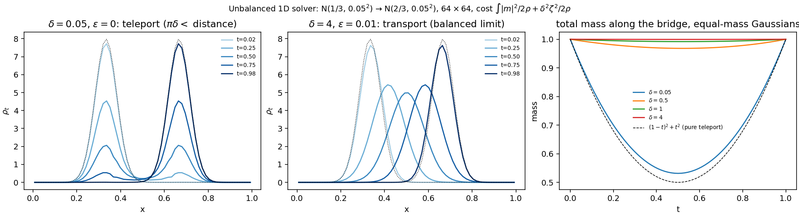

# Unbalanced (source-term) dynamic transport in 1D — implementation and tests

*17 October 2026. Code: `python/optimal_transport/{state,prox,projection,pipeline}_unbalanced.py`;
tests: `python/scripts/validate_unbalanced.py`; figure: `figures/unbalanced_1d.png`. Nothing in the
balanced solver was modified.*

## Problem

Wasserstein–Fisher–Rao transport with diffusion:

    min   ∫∫ |m|²/(2ρ) + (δ²/2) ζ²/ρ  dx dt
    s.t.  ∂_t ρ + ∂_x m − ε ∂_xx ρ = ζ,    ρ(0)=ρ₀, ρ(1)=ρ₁ (masses may differ), m = 0 on the walls.

δ is the WFR length scale: in the metric ds² = |v|² + δ² g² (g = ζ/ρ the growth rate) two far-apart
lumps are moved if their separation is below πδ and destroyed/recreated in place above it.
δ → ∞ recovers the balanced problem; ε = 0 is allowed.

## Implementation: three local changes

Write s = δζ. Then the reaction cost is s²/(2ρ), the same perspective function as the kinetic
energy, and the constraint reads ∂_t ρ + ∂_x m − ε∂_xx ρ − s/δ = 0.

1. **State**: a third field s on the cell-centre grid (nt, nx), where the FP residual lives, so the
   LADMM coupling operator A is the identity on s and ‖A‖ ≤ 1 is unchanged (same γ, τ, stopping rule).
2. **Projection**: the constraint operator is M = [A_FP, −I/δ], so M Mᵀ = A_FP A_FPᵀ + I/δ². Every
   per-mode tridiagonal system in time gets +1/δ² on its diagonal; the spatial DC mode, singular in
   the balanced case (mass conservation), becomes regular. Correction for s: s ← s + φ/δ.
   (`projection_unbalanced.py`, CN/banded scheme; the ETD variant would take the same +1/δ².)
3. **Prox**: the KE cubic with m² replaced by m² + s², and s updated like m (`prox_unbalanced.py`).

## Tests (64 × 64, γ = 1, 15 000 iterations unless stated)

| test | reference | result |
|---|---|---|
| T1 uniform → 2·uniform, ε = 0.01, δ = 0.3 | Hellinger path ρ_t = ((1−t)+t√2)², m = 0, cost 2δ²(√2−1)² | ρ to 4.7e-7, m = 0, cost 0.03088 exact; converged in 53 iterations |
| T2 Gaussian → 2·Gaussian, ε = 0, δ = 0.3 | same closed form (pure reaction optimal for ρ₁ = cρ₀) | ρ to 8.8e-6, max m/ρ 6e-7 |
| T3 compact bumps at 1/3, 2/3 (gap 0.19 > πδ = 0.157), ε = 0, δ = 0.05 | exact optimum of the discrete pure-reaction problem (L-BFGS on the shared time profile): 0.009829 | feasible cost 0.009835 → 0.009831 at 60k iterations; y-side cost 0.009792 → 0.009823 (sandwich); ρ path within 9e-3, drifting slowly along a flat direction; KE 5e-6 |
| T3′ same bumps, δ = 0.1 (πδ = 0.31 > gap) | transport should now be used | KE 0.0126, reaction 0.0229, total 0.0355 < pure teleport 0.0400; mass dips to 0.56 |
| T4 equal-mass Gaussians 1/3 → 2/3, ε = 0.01, δ = 0.5, 1, 2, 4 | balanced solver (which is 4.9e-3 from the analytic SB on this grid) | rel. difference in ρ 3.7e-2, 9.3e-3, 2.4e-3, 5.9e-4: a factor 4 per doubling of δ, i.e. ∝ 1/δ² |
| T5 Gaussian 0.35 → 1.5 × Gaussian 0.6, ε = 0.01, δ = 0.4 | KKT: m/ρ = ∂_x(δ s/ρ) (from m = ρ φ_x, s = ρφ/δ) | median rel. error 8e-5, 90th percentile 1.5e-4 |
| T6 same run | discrete mass balance d/dt ∫ρ = ∫ s/δ | 1.4e-13 |

Notes. Gaussians are not a sharp teleport test: their tails are closer than πδ and a little
mass is transported between them (cost 0.0095 < pure teleport 0.0100), so T3 uses compactly
supported bumps. The discrete pure-reaction optimum differs from the continuum (1−t)² path by
O(dt) at the vanishing endpoint (the last time step costs half as much in the staggered
discretization), so the reference is the discrete optimum, not the continuum formula. The strict
stopping rule (eps_rel 1e-8) is rarely met within 15k iterations, exactly as for the balanced 1D
solver at this grid.

## What 2D and 3D need

The same three changes: one more field on the cell-centre grid, +1/δ² on the diagonal of the
per-mode time solve (and in the DC mode), and m² → |m|² + s² in the cubic. The DCT structure,
the jitted LADMM loop and the mixed-precision path are untouched. A density floor is not needed
for the source term itself; the prox already handles ρ → 0.

Benchmarks for the 2D/3D versions: T1 (uniform scaling, exact for any ε), T2 and T3 at ε = 0,
the 1/δ² convergence to the balanced solver, and, for a nontrivial exact value at ε = 0, the
static Kantorovich form of WFR (cost −2δ² log cos(min(|x−y|/(2δ), π/2)) with KL marginal
penalties) solved by LP on a coarse grid.

